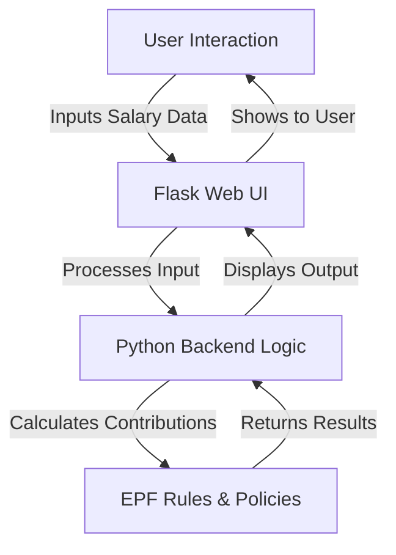

# EPF Calculator


## 🚀 Executive Summary
EPF Calculator is a highly intuitive and accessible tool designed to help employees in Malaysia estimate their Employee Provident Fund (EPF) contributions. By combining Python's computational strength and Flask's web capabilities, it streamlines complex financial calculations, providing users with transparent insights into their savings.

## ✨ Key Features
- **Accurate EPF Calculation**: Generate precise calculations for employee and employer contributions based on user-specified salary inputs.
- **Web UI Integration**: Accessible via a user-friendly web interface powered by Flask.
- **Dynamic Updates**: Easily customize and update based on the latest EPF regulations or salary structures.
- **Real-World Usability**: Designed for employees, HR practitioners, and financial advisors to make informed financial planning decisions.
- **Portable & Scalable**: Lightweight architecture ensures seamless deployment and scaling for multiple users.

## 📐 Architecture & Workflow


## 🛠 Tech Stack & Tools Breakdown
| Component        | Technology      | Purpose                                                                 |
|------------------|-----------------|-------------------------------------------------------------------------|
| **Backend**      | Python (3.9+)   | Core logic for calculating EPF contributions                           |
| **Web Framework**| Flask           | Lightweight framework powering the web interface                       |
| **Frontend UI**  | HTML/CSS        | Simplistic interface for user accessibility                            |
| **Version Control**| Git/GitHub     | Collaborative platform for code hosting and versioning                 |
| **License**      | MIT             | Determined to keep the project open-source for further customization   |

## ⚡ Quickstart / Installation

Follow these steps to clone and run EPF Calculator locally:

1. Clone the repository:
   ```bash
   git clone https://github.com/EF361/epf-calculator.git
   cd epf-calculator
   ```

2. Create and activate a virtual environment:
   ```bash
   python3 -m venv env
   source env/bin/activate   # On Windows, use `env\Scripts\activate`
   ```

3. Install dependencies:
   ```bash
   pip install -r requirements.txt
   ```

4. Run the Flask application:
   ```bash
   flask run
   ```

5. Access the application in your browser:
   ```
   http://127.0.0.1:5000
   ```

## 🖋 About the Developer
This project was built by **Alicia Goh** ([@EF361](https://github.com/EF361)), a versatile AI & Software Engineer committed to designing accessible, data-driven applications that simplify user experiences in financial and technical domains.