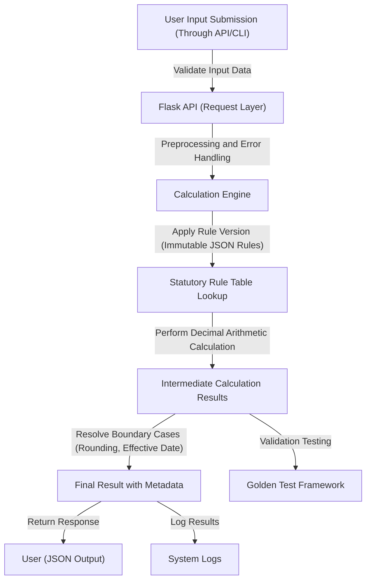

# EPF Calculator  
[](https://www.python.org/downloads/release/python-390/)  
[](https://flask.palletsprojects.com/)  
[](./LICENSE)  
[](https://github.com/EF361/epf-calculator/actions)  
[](#)  

## Executive Summary
The **EPF Calculator** is a robust and transparent statutory financial calculation tool designed to compute Employee Provident Fund (EPF) contributions with precision and compliance. It ensures adherence to regulatory requirements while enabling secure, reliable, and versioned rule management.

---

## Key Features
- **Versioned Statutory Rule System**  
  Rule tables are stored as immutable, machine-readable JSON with metadata, including source URLs, retrieval dates, checksums, and reviewer approvals.

- **Accurate Decimal Arithmetic**  
  Leveraging Python's `Decimal` for precise, non-floating-point-safe financial calculations.

- **Comprehensive Test Coverage**  
  Automated testing for every boundary condition (age categories, citizenship, wage thresholds, effective dates, rounding rules) and property-based validation of monotonicity, invariants, and agreement with official examples.

- **Transparent Calculation Responses**  
  Outputs include rule-set version, effective date, inputs, intermediate values, rounding decisions, and source references for complete traceability.

- **Secure Update Monitoring**  
  Automated source monitoring proposes updates, with human-review requirements for rule activations and rollback capabilities.

- **CSRF-Protected API**  
  Built with Flask, ensuring secure API interactions with modern protection protocols.

- **Golden Testing Support**  
  Validates correctness against official worked examples for bulletproof confidence in outputs.

---

## Architecture & Workflow
The EPF Calculator is designed with a modular separation of concerns. The **calculation engine** operates independently of the Flask API layer to maximize maintainability and reusability. Below is the workflow overview:



---

## Tech Stack & Tools Breakdown
- **Programming Language**: Python 3.9+
- **Web Framework**: Flask 2.x (with CSRF protection)  
- **Financial Arithmetic**: `Decimal` module (for compliance-grade precision)  
- **Testing Frameworks**: `pytest`, property-based testing via `hypothesis`  
- **Data Storage**: Immutable JSON for statutory rule tables  
- **CI/CD**: GitHub Actions (with automated build, test, and coverage reports)  
- **Additional Tools**: Tools for monitoring and proposing statutory table updates, golden test validation framework  

---

## Quickstart / Installation
Follow these steps to get started with the project locally:

1. **Clone the Repository**  
   ```bash
   git clone https://github.com/EF361/epf-calculator.git
   cd epf-calculator
   ```

2. **Set Up Virtual Environment**  
   ```bash
   python3 -m venv venv
   source venv/bin/activate   # On Windows: venv\Scripts\activate
   ```

3. **Install Dependencies**  
   ```bash
   pip install -r requirements.txt
   ```

4. **Run Tests**  
   Ensure all tests pass before running the application:  
   ```bash
   pytest --cov=epf_calculator tests/
   ```

5. **Start the Application**  
   Launch the Flask server:  
   ```bash
   flask run
   ```

6. **Access the Application**  
   Navigate to `http://127.0.0.1:5000` in your browser or use tools like `curl` to interact with the API.

7. **Usage Example**  
   Sample API request for calculation:  
   ```bash
   curl -X POST \
   -H "Content-Type: application/json" \
   -d '{"age": 30, "citizenship": "resident", "monthly_wage": 4500.00}' \
   http://127.0.0.1:5000/api/calculate
   ```

---

## Contributing
Contributions, bug reports, and feature requests are welcome! Please create an issue or submit a pull request to start a discussion.

---

## License
This project is licensed under the MIT License. See the [LICENSE](./LICENSE) file for details.

---

## Acknowledgements
Developed by **Alicia Goh (EF361)**, an exceptional AI and Software Engineer, this project reflects best practices in transparent, auditable, and precision-focused software engineering.