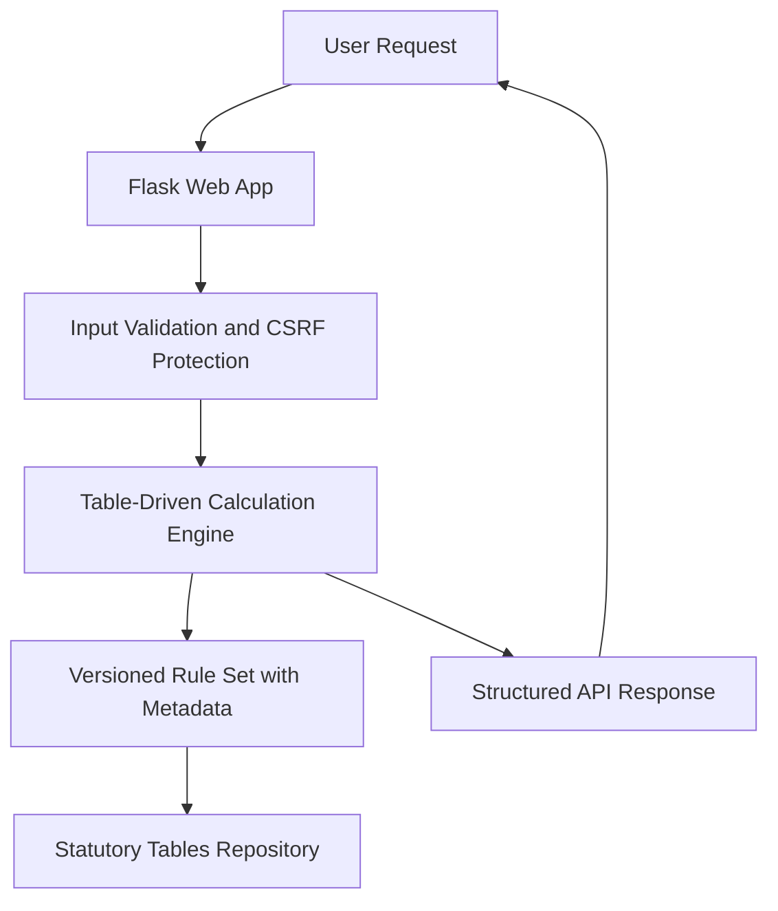

# EPF Calculator


## Executive Summary

The **EPF Calculator** is a robust and accurate tool for statutory **Employee Provident Fund (EPF)** calculations based on official government contribution tables. It ensures legally compliant, versioned, and transparent calculations while providing automated updates for rule-set changes.

## Key Features

- **Versioned Rule Sets**:
  - Incorporates statutory contribution tables with metadata (effective date, source URL, checksum).
  - Highlights human-reviewed updates and tracks official source changes.

- **Precision Arithmetic**:
  - Adheres to financial-grade standards using Python `Decimal` for exact and predictable calculations.
  - Prohibits binary floating-point math for the core calculation layer.

- **Boundary and Golden Tests**:
  - Comprehensive boundary tests for thresholds, age, citizenship, and effective-date-specific calculations.
  - Golden tests derived directly from official EPF examples ensure real-world accuracy.

- **Production-Ready Deployment**:
  - Hardened Flask application with CSRF protection, input validation, and structured error handling.
  - Comprehensive security through dependency scanning and strict configuration management.

- **Transparent Results**:
  - Displays all rule versions and sources used for every result.
  - Includes a clear, non-authoritative disclaimer for end users.

- **Automated Alerts**:
  - Monitors official contribution-table changes and sends alerts for updates.
  - Requires explicit human review to activate new rule sets.

- **Scalable Architecture**:
  - Separates Flask request handling from a table-driven financial engine for flexibility and maintainability.
  
## Architecture & Workflow



## Tech Stack

- **Backend**: Python 3.9+, Flask
- **Frontend**: HTML5, CSS3 (for API interface or visual demo)
- **Core Calculation Logic**: Python `decimal` and table-driven system
- **Testing**: `pytest` (unit tests, golden tests, boundary tests)
- **Security Tools**: Dependency scanning, CSRF protection
- **Automation & Alerts**: Monitoring for official rule changes via configurable alerting system

## Quickstart / Installation

Follow the steps below to set up and start the EPF Calculator application.

### Prerequisites
- Python 3.9 or higher
- Virtual environment tool (optional but recommended)

### Setup Instructions

1. **Clone the Repository**
   ```bash
   git clone https://github.com/EF361/epf-calculator.git
   cd epf-calculator
   ```

2. **Create and Activate a Virtual Environment**
   ```bash
   python3 -m venv venv
   source venv/bin/activate   # On Windows: venv\Scripts\activate
   ```

3. **Install Dependencies**
   ```bash
   pip install -r requirements.txt
   ```

4. **Run Tests**
   ```bash
   pytest
   ```

5. **Start the Application**
   ```bash
   flask run --host=0.0.0.0 --port=5000
   ```

6. **Access the Application**
   Open your browser and navigate to: `http://127.0.0.1:5000/`

## Disclaimer

This tool is designed for illustrative and testing purposes. While it strives for accuracy based on official EPF rules, **it is not an authoritative source** for financial or statutory compliance. Users should verify all outputs with official sources.